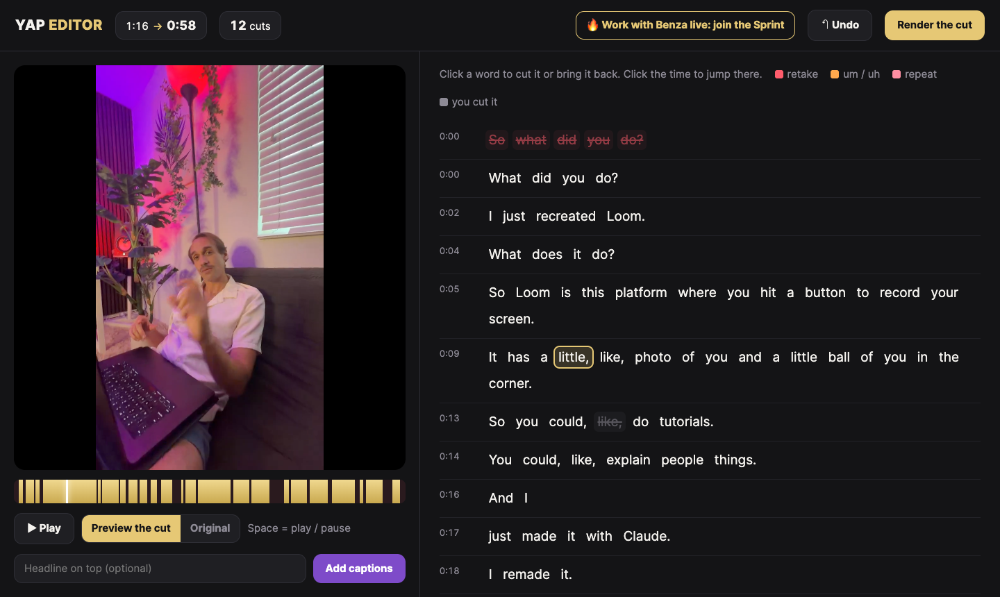

# 🎙️ Yap Editor

**Talk to the camera. Get back a clean, captioned video.**

Free from **@thoseaiguys** 🎁

> 🔥 **Want AI to run your marketing, not just your edits?** Work with **Benza** live in the **AI Marketing Sprint**. Seats are limited. **[Join now →](https://sprint.benzamaman.com/?utm_source=github&utm_medium=owned&utm_campaign=sprint-close&utm_content=yap-editor-top)**
>
> 💬 **Questions?** Reply to any of Benza's emails, or write to **benza@benzamaman.com**. Ask anything.



```
 📱 your raw video   ──▶   🧠 WhisperX hears every word   ──▶   ✂️ ums, repeats & retakes cut   ──▶   🖱️ you click to fix   ──▶   🎬 captions + headline
```

---

## ✨ What it does

| | |
|---|---|
| 🧠 **Hears every word** | WhisperX writes down everything you said, with the exact time of every word. |
| ✂️ **Cuts the mess for you** | "Um", "uh", "I I", and lines you said twice. It keeps your **last take**. |
| 🤫 **Kills dead air** | The pauses between lines are gone, so the video moves. |
| 🖱️ **Edit by clicking words** | Your video on the left, your words on the right. Click a word to cut it. Click again to bring it back. |
| 💬 **Captions + headline** | Big word-by-word captions and a headline bar on top, ready for Reels, TikTok and Shorts. |
| 🔒 **Runs on your computer** | Free. No uploads, no account. Your original video is never changed. |

---

## 🚀 Install (one time, about 10 minutes)

You need a **Mac** and **[Claude Code](https://claude.com/claude-code)**.

**Easiest:** open Claude Code and paste this:

> Install the Yap Editor skill from https://github.com/EnergySteve/yap-editor into `~/.claude/skills/yap-editor` and run its setup.sh

**Or by hand,** in Terminal:

```bash
git clone https://github.com/EnergySteve/yap-editor ~/.claude/skills/yap-editor
bash ~/.claude/skills/yap-editor/setup.sh
```

`setup.sh` installs ffmpeg, Node, Python and WhisperX. Already have them? It skips them.

---

## 🎬 Use it

### 1. Tell Claude to yap it

Drag your video into Claude Code and say:

> **yap this**

Claude listens to your video (about 1 minute per minute of video) and opens the editor in your browser.

### 2. Click to fix

| Colour | Means |
|---|---|
| 🟥 red, crossed out | a **retake** (you said that line again later) |
| 🟧 orange, crossed out | **um / uh** |
| 🩷 pink, crossed out | a **repeat** ("I I think") |
| ⬜ grey, crossed out | **you** cut it |
| plain white | kept |

- 🖱️ **Click a word** to cut it, or click again to bring it back.
- ▶️ **Preview the cut** plays it exactly how it will come out.
- ⏪ **Cmd + Z** undoes. **Space** plays and pauses.

### 3. Export

- **Render the cut** gives you `cut.mp4`: a clean 1080p video.
- Type a headline, then **Add captions** gives you `final.mp4`: with captions and the headline. 🎉

Everything lands in a folder next to your video called `your-video-yap/`.

> 🚀 **Made your first video?** This is one small piece of what Claude can do for your marketing. Build the rest with **Benza live** in the AI Marketing Sprint. **[Grab a seat →](https://sprint.benzamaman.com/?utm_source=github&utm_medium=owned&utm_campaign=sprint-close&utm_content=yap-editor-use)**

---

## 💡 Tips for the best cut

- 🔁 **Messed up a line? Just say it again.** It keeps the last take.
- ⏸️ **Pause for a beat** before you redo a line. That helps it spot the retake.
- 🎤 Any phone mic works. Less background noise means better words.
- 🗣️ Talk fast? If a word you cut still sneaks through, cut the word next to it too.
- ✍️ Keep the headline short: **6 words or less**.

---

## 🛠️ Without Claude (Terminal)

```bash
python3 yap.py cut my-video.mov                              # auto-cut + open the editor
python3 yap.py edit my-video-yap                             # reopen the editor
python3 yap.py render my-video-yap                           # render the cut
python3 yap.py captions my-video-yap --headline "Hook here"  # captions + headline
```

---

## ❓ Help

| Problem | Fix |
|---|---|
| "WhisperX is not installed" | Run `bash setup.sh` |
| "Homebrew isn't installed" | Paste the one line it shows you into Terminal, then run `bash setup.sh` again |
| The first video is slow | It's downloading the speech models (about 1 GB). Only the first time. |
| "didn't hear any talking" | This is for talking videos, not music or b-roll |
| The editor won't open | Go to **http://localhost:8765** in your browser |
| Anything else | **Reply to Benza's email** or write to **benza@benzamaman.com**. Any and all questions! |

---

Built with [WhisperX](https://github.com/m-bain/whisperX), [ffmpeg](https://ffmpeg.org) and [HyperFrames](https://github.com/heygen-com/hyperframes).

## 🔥 Work with Benza live

The Yap Editor is a free taste. In the **AI Marketing Sprint**, Benza works with you live so AI runs your whole marketing: content, emails, ads and follow-up.

**Seats are limited. [Join the Sprint →](https://sprint.benzamaman.com/?utm_source=github&utm_medium=owned&utm_campaign=sprint-close&utm_content=yap-editor-bottom)**

💬 Questions about the Yap Editor or the Sprint? **Reply to Benza** at **benza@benzamaman.com**. Any and all questions are welcome.

---

Made with ⚡ by **@thoseaiguys**, a free gift for everyone in the Claude Content & Marketing Masterclass with Benza.
